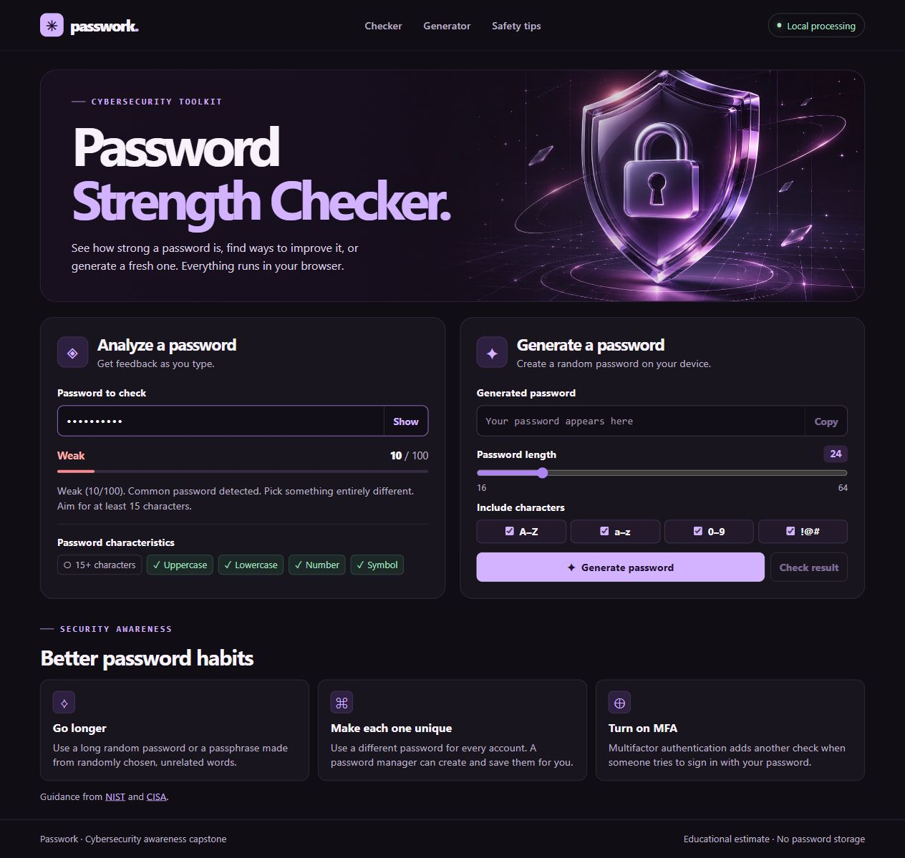
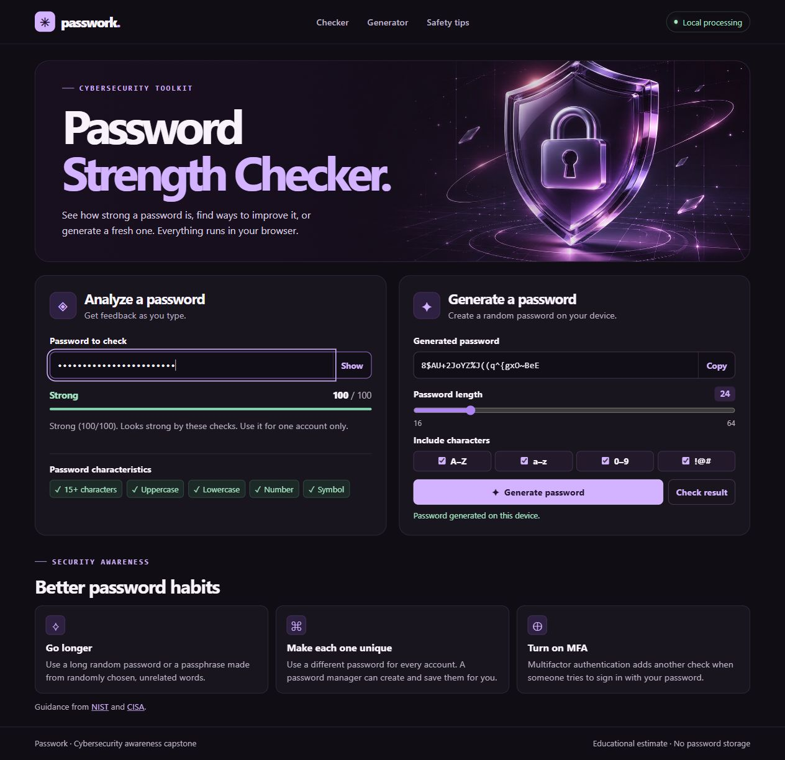
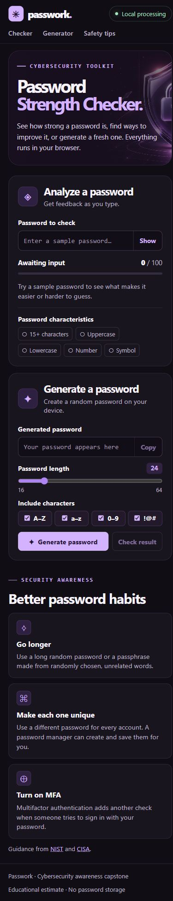
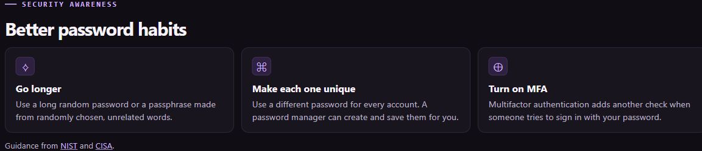
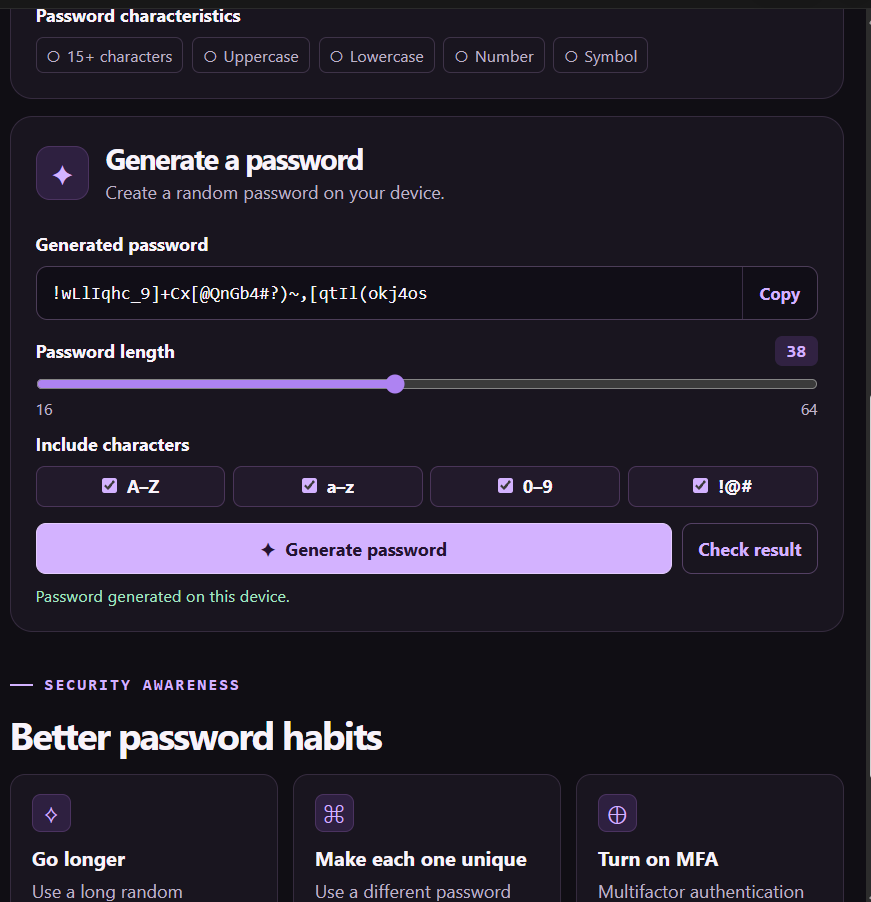
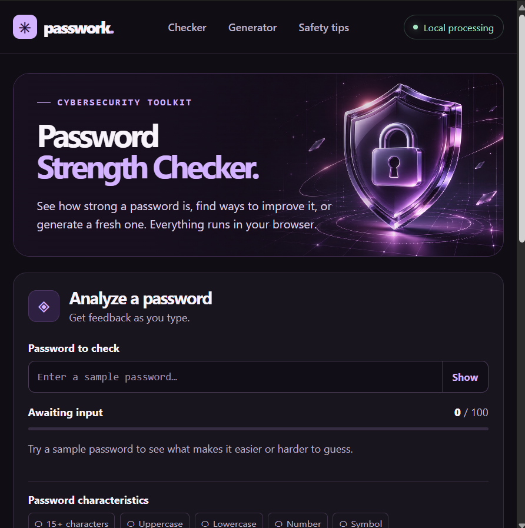

# Passwork

**Password Strength Checker · Lenovo Cyber Security Final Capstone**

**Submitted by Evelyn**

Passwork is a browser-local web application that scores sample passwords, explains weaknesses, and generates random passwords. It uses HTML, CSS, and plain JavaScript with zero runtime dependencies.

## 1. Problem statement

Many users are unaware of how to create strong passwords, making their accounts vulnerable to hacking. Short passwords, common choices, and predictable patterns make a password easier to guess. Reusing a password lets a breach on one service put unrelated accounts at risk.

## 2. Project objective

Help users recognize weak password habits and give them a practical way to create long, random, unique passwords. Demonstrate how a web application can give feedback while handling user input locally.

## 3. Solution description

- **Checker.** Type a sample password to see its score from 0 to 100, strength band, observed character types, and targeted suggestions. Show or hide the input as needed.
- **Scoring.** The educational heuristic weighs length and distinct characters, with a small contribution for character variety. Caps lower the score for short inputs, a bundled list of common choices and simple variants, familiar sequences, repeated patterns, and number-only passwords. Weak scores are 0–39, fair scores 40–69, and strong scores 70–100. A blank input displays “Awaiting input.”
- **Generator.** Choose 16–64 characters and one or more character groups. `crypto.getRandomValues()` supplies random bytes. Rejection sampling removes modulo bias and excludes candidates missing a selected group. Copy the result explicitly or send it directly to the checker. Numeric-only output is supported for compatibility and receives a lower score.
- **Privacy.** Passwords are held in the page during use. The app uses no analytics, account system, persistence, or network requests for analysis. The Copy button writes to the device clipboard when permitted.
- **Awareness.** The interface covers long passwords, unique credentials, password managers, and multifactor authentication. The character checklist describes observed properties. The score estimates guessability using simple rules and does not measure entropy, predict cracking time, check breach databases, or guarantee safety. NIST recommends a 15-character minimum for single-factor passwords and advises verifiers against mandatory character composition rules. [NIST SP 800-63B-4](https://pages.nist.gov/800-63-4/sp800-63b.html) · [CISA Secure Our World](https://www.cisa.gov/sites/default/files/2024-09/Secure-Our-World-4-Easy-Ways-Stay-Safe-Online-Tip-Sheet.pdf)

### Run and demonstrate

Open the [private live demo](https://passwork-password-capstone.etherealclove2.chatgpt.site) using the owning ChatGPT account, or run the source locally for a demonstration without a sign-in.

Open `dist/index.html` in a modern browser. For reliable clipboard access, serve `dist/` over localhost or HTTPS. For example, if Python is installed, from the project root run `python -m http.server 8000 --bind 127.0.0.1 --directory dist` and open `http://127.0.0.1:8000/`. No installation or build is required.

1. Enter the demonstration string `Password1!` and review the weak rating and common-password feedback.
2. Toggle Show and Hide. Clear the field and verify that the interface resets.
3. Set the generator to 24 characters and leave all groups selected. Generate a fresh password, then choose **Check result** to assess it.
4. Try changing the length and character groups. The previous result clears. You can generate again with the new settings.
5. Read the security-awareness cards and repeat the flow at a narrow viewport.

### Verification

Browser tests covered common-password feedback, show and hide, password generation, transfer into the checker, clipboard copy, the 64-character slider limit, validation when no groups are selected, and the mobile layout. The generator also passed 675 checks across all 15 nonempty combinations of character groups at lengths of 16, 24, and 64.

### Source layout

| Path | Purpose |
| --- | --- |
| `dist/index.html` | Application markup and awareness content |
| `dist/styles.css` | Theme, layout, and responsive styling |
| `dist/passwords.js` | Password analysis and random generation |
| `dist/app.js` | Interface events and rendering |
| `dist/assets/shield.jpg` | Generated hero illustration |
| `screenshots/` | Browser screenshots for the submission |

## 4. Application screenshots

## 5. Open source code link

[Evelyn’s Password Strength Checker repository on GitHub](https://github.com/Evelyn920/Evelyn_Password_Strength_Checker)

The ZIP includes `Passwork-Evelyn.git.bundle`, a portable copy of the Git repository with the source, documentation, and screenshots. To restore it, extract the ZIP and run `git clone Passwork-Evelyn.git.bundle Passwork-Evelyn-repo` from the extracted directory.

## 6. Future scope

- Evaluate a larger, licensed offline list of common passwords with multilingual coverage.
- Compare the heuristic with a mature offline strength estimator and document false positives and false negatives.
- Add an optional generator that selects words at random from a bundled passphrase word list.
- Evaluate keyboard and screen-reader behavior across additional browser and device combinations.

## License and artwork

The project is available under the MIT License. The hero illustration was generated for this project using OpenAI image generation. Screenshots contain demonstration values only.

